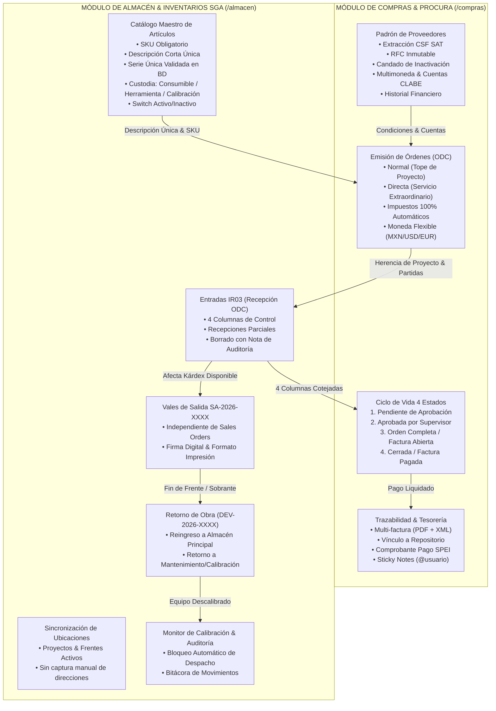

# SIFYGSA BUSINESS SUITE ERP — ESPECIFICACIÓN TÉCNICA Y OPERATIVA
## Módulos de Compras & Procura y Almacén & Control de Inventarios (SGA)

> [!NOTE]
> **Documento Oficial de Arquitectura, Flujos y Reglas de Negocio**  
> **Versión del Sistema:** v3.5.0 Enterprise ERP  
> **Ubicación:** Raíz del Proyecto (`/DOCUMENTO_TECNICO_COMPRAS_Y_ALMACEN_SIFYGSA.md`)  
> **Área de Cobertura:** Módulo de Compras (`/compras`) y Módulo de Almacén (`/almacen`)  
> **Stack de Desarrollo:** Next.js 15 (App Router), React 18, TypeScript, TailwindCSS + Tokens CSS Modulares, Context API (`ComprasContext` y `AlmacenContext`), Material Symbols & Lucide.  
> **Estado de Compilación:** `npx tsc --noEmit` completado exitosamente con **0 errores**.

---

## 1. Resumen Ejecutivo y Arquitectura de Integración

El sistema **SIFYGSA Business Suite ERP** optimiza la cadena de suministros y procura técnica para operaciones industriales y petroleras de alto riesgo (PEMEX, CFE, Tenaris Tamsa).



---

## 2. Reglas Globales y Restricciones Estrictas de Operación

1. **NO creación de módulo de Requisiciones:**
   * El flujo opera directamente desde las Órdenes de Compra (Normales y Directas).
   * Los códigos o notas de requisición (`RQ-127/26`) son campos de trazabilidad y herencia automática que no requieren un módulo ni tablas intermedias.
2. **NO creación de submódulo independiente de Impuestos ni Contabilidad para el operador:**
   * Los compradores y almacenistas no capturan combinaciones manuales de impuestos ni cuentas contables.
   * El cálculo fiscal es **100% automático** en cada partida según la tasa fiscal seleccionada (`TasaFiscalPartida`):
     * `IVA_16` (+16% IVA)
     * `RET_ISR_1_25` (+16% IVA, -1.25% Retención ISR para personas físicas RESICO)
     * `RET_IVA_4` (+16% IVA, -4% Retención IVA en transporte/fletes)
     * `RET_IVA_10_66` (+16% IVA, -10.66% Retención IVA en servicios profesionales)
     * `EXENTO` (Tasa 0% / Exento)
   * Esto elimina por completo la duplicación innecesaria de artículos en el catálogo.
3. **Eliminación de campos basura y redundancias:**
   * Subsidiaria predeterminada: `"SIFYGSA Fire & Gas S.A. de C.V."` de forma implícita.
   * La descripción corta (`descripcionCorta`) se captura una única vez en el alta del artículo y se hereda automáticamente a compras, almacén y ventas.

---

## 3. Módulo de Compras (`/compras`)

### 3.1. Submódulo de Proveedores (`/compras/proveedores` y `/compras/proveedores/nuevo`)

#### A. Extracción Simulada por Constancia de Situación Fiscal (CSF)
* **Zona de Carga Drag & Drop:** Permite arrastrar el PDF de la CSF o seleccionar archivo.
* **Extracción Automatizada de Datos Fiscales:** Simula la lectura del documento SAT y autocompleta:
  * RFC
  * Razón Social y Denominación Oficial
  * Tipo de Persona (`moral` | `fisica`)
  * Régimen Fiscal (ej. *601 General de Ley Personas Morales*, *626 RESICO*)
  * Código Postal y Domicilio Fiscal Completo
* Mantiene disponible en todo momento la captura y edición manual asistida.

#### B. Candados de Validación Estricta
* **RFC Obligatorio e Inmutable:** El campo RFC es estrictamente obligatorio para guardar el proveedor y queda bloqueado contra edición posterior (indicador visual de candado). Si el contratista cambia de razón social o RFC, la regla de negocio exige inhabilitar el proveedor actual y dar de alta uno nuevo.
* **Candado de Inactivación Lógica:** Si un usuario intenta pasar el estatus de un proveedor a `inactivo` o `suspendido`, el sistema valida si existen Órdenes de Compra abiertas o pendientes de pago en `ComprasContext`. Si existen, **bloquea el guardado** y muestra una alerta con el número de órdenes activas y su folio.

#### C. Multimoneda y Cuentas Bancarias Homologadas
* **Moneda Principal:** Asignación de divisa base (`MXN`, `USD`, `EUR`).
* **Monedas Secundarias:** Múltiples divisas habilitadas para emisión de órdenes.
* **Cuentas Bancarias Homologadas:** Registro de múltiples cuentas (Banco, No. Cuenta, CLABE Interbancaria validada a 18 dígitos, Titular que debe coincidir con el RFC, divisa y marca de Cuenta Principal).

#### D. Notificación a Administración y Tesorería
* Al registrar o actualizar datos bancarios/fiscales de un proveedor, el sistema despliega un modal de confirmación para notificar automáticamente al área de Administración con el expediente adjunto (CSF, Opinión 32-D y Carátula Bancaria).

#### E. Modal de Detalle con 3 Pestañas de Historial Financiero
1. **Pestaña 1: Expediente General & Fiscal:** Candado visual de RFC no modificable, razón social, régimen, domicilio, contacto y cumplimiento SAT 32-D.
2. **Pestaña 2: Cuentas Bancarias & Multimoneda:** Monedas autorizadas, líneas de crédito, días de crédito y desglose de cuentas CLABE con estatus activo.
3. **Pestaña 3: Historial Financiero & Facturas:**
   * KPIs: Monto Total Acumulado Facturado, Total Pendiente por Pagar y Total Liquidado.
   * **Facturas Abiertas (Pendientes de Pago):** Tabla con Folio, UUID, Orden de Compra ligada, fecha de emisión, fecha de vencimiento (contado o crédito a 30 días) y monto.
   * **Facturas Pagadas / Cerradas:** Tabla con Folio, UUID, OC ligada, monto pagado, fecha de liquidación y **botón interactivo para ver/descargar el Comprobante de Pago Bancario (SPEI BBVA/Banamex)**.

---

### 3.2. Submódulo de Órdenes de Compra (`/compras/ordenes/nueva` y `/compras/ordenes/[id]`)

#### A. Selector de Tipo de Orden: Normal vs. Directa
* **Orden de Compra Normal (`normal`):**
  * Vinculada obligatoriamente a Contrato / Proyecto activo (`SFG-C259-TAM`, `SFG-C307-LAG`, etc.).
  * Tope de cantidades: las partidas heredadas respetan el límite asignado en la ingeniería o catálogo, impidiendo que el operador exceda las cantidades autorizadas.
* **Orden de Compra Directa (`directa`):**
  * Para compras imprevistas, fletes urgentes (DHL, maniobras), servicios menores o consumibles de último minuto.
  * Vinculada al rol del Comprador y Gerente de Adquisiciones.
  * Permite captura de precio unitario estimado.
  * Incluye campo libre de **Referencia a Servicio Extraordinario** para ligar a qué equipos o POs existentes corresponde el gasto.

#### B. Flexibilidad de Moneda
* Permite alternar la divisa de la orden (`MXN`, `USD`, `EUR`) en el detalle de la orden con recálculo de tipo de cambio y guardado persistente instantáneo, sin anular los registros previos ni reiniciar el formulario.

#### C. Ciclo de Vida Operativo de 4 Estados
1. `pendiente_aprobacion`: Emitida por el comprador, esperando visto bueno de supervisión.
2. `aprobada_supervisor`: Autorizada formalmente; esperando factura XML/PDF del proveedor.
3. `orden_completa_factura_abierta`: Factura cargada, validada ante el SAT e ingresada a programación de pago.
4. `cerrada_factura_pagada`: Pago liquidado por Tesorería y comprobante bancario adjuntado.

#### D. Soporte Multi-Factura y Repositorio de Documentos
* Soporta la vinculación de 1 o más facturas fiscales (XML + PDF) hasta cuadrar el monto total de la orden.
* Permite **Vincular Archivos del Repositorio Centralizado** con un solo clic.

#### E. Comprobante de Pago y Registros Relacionados
* Modal de registro de pago de Tesorería (`REGISTRAR_COMPROBANTE_PAGO`): captura referencia bancaria (ej. `SPEI-BBVA-99412`), monto pagado y comprobante.
* El comprobante queda disponible para visualización y descarga en la pestaña de **Registros Relacionados** de la orden y en el historial del proveedor.

#### F. Sistema de Sticky Notes Interactivo
* Comunicación interna entre compradores, almacenistas y administración.
* Soporta notas públicas o dirigidas (`@administracion`, `@comprador`, etc.), marcas de tiempo automáticas y casilla interactiva **"Enterado / Hecho"** con trazabilidad de quién y cuándo lo confirmó.

---

## 4. Módulo de Almacén (`/almacen`)

### 4.1. Catálogo Maestro de Artículos (`/almacen/articulos/nuevo` y `/almacen`)

* **Estructura Técnica Limpia:**
  * **SKU Obligatorio y Único:** Clave alfanumérica de identificación física.
  * **Descripción Corta Única:** Capturada una sola vez y heredada automáticamente a Compras y Ventas.
  * **Marca y Modelo:** Campos independientes para especificación técnica.
  * **Unidades de Medida Estándar:** Catálogo cerrado de 15 unidades homologadas SAT (`Pieza`, `Par`, `Caja`, `Paquete`, `Metro`, `Metro Cuadrado`, `Metro Cúbico`, `Litro`, `Galón`, `Kilogramo`, `Bobina`, `Bulto`, `Kit`, `Juego`, `Servicio`).
  * **Precio de Referencia (MXN):** Valor estimado para valuación de kárdex.
* **Buscador de Claves SAT Integrado:** Selector y buscador en vivo de códigos de producto/servicio SAT (`26121600`, `41111900`, `40141600`, `46181500`, etc.).
* **Control de Series Únicas:** Checkbox que activa la captura de números de serie y ejecuta la función `validarSerieUnica`, asegurando que no existan duplicados en toda la base de datos de Almacén.
* **Clasificación de Custodia:**
  * `Consumible`: Material fungible no sujeto a retorno.
  * `Herramienta Retornable (Activo)`: Sujeto a préstamo de obra y control de entrega/devolución.
  * `Equipo Sujeto a Calibración / Mantenimiento`: Requiere fecha de calibración y certificación metrológica.
* **Switch Visible de Estatus:** Selector interactivo de estado `Activo` vs `Inactivo`.

---

### 4.2. Sincronización Automática de Ubicaciones

* Eliminación de la captura manual de direcciones de entrega y bodegas.
* Sincronización automática mediante el catálogo maestro de contratos activos (`PROYECTOS_UBICACIONES_CATALOG`):
  * `SFG-C259-TAM` — Planta Tenaris Tamsa (Veracruz) / Bodega de Maniobras Tamsa
  * `SFG-C307-LAG` — Central Nucleoeléctrica Laguna Verde CFE / Bodega Técnica Laguna Verde
  * `SFG-C182-DOS` — Refinería Olmeca Dos Bocas PEMEX / Andén Recepción Dos Bocas
  * `SFG-C104-AKA` — Complejo Marino Cantarell Akal-C / Muelle y Andén de Embarque Carmen
  * `SFG-ALM-CDMX` — Almacén Central Corporativo (Sede CDMX) / Nave Industrial 1 y 2

---

### 4.3. Recepción de Mercancías IR03 (`/almacen/recepciones/ir03`)

* **Basada en Órdenes de Compra (PO):** Selección de la orden autorizada con herencia inmediata del proyecto y ubicación predeterminada.
* **Cambio Masivo de Ubicación:** Botón de 1 clic para modificar la bodega/nave de destino en todas las partidas simultáneamente.
* **4 Columnas de Control de Recepción:**
  1. `Cantidad Solicitada (PO)`: Cantidad contractual autorizada.
  2. `Cantidad Facturada`: Cantidad amparada en la factura/remisión.
  3. `Cantidad Recibida Físicamente`: Cantidad contada y verificada en el andén.
  4. `Stock Disponible en Almacén Principal`: Existencia física actualizada en kárdex.
* **Recepciones Parciales:** Permite recibir entregas divididas manteniendo el saldo pendiente para entregas futuras.
* **Borrado Reversible con Nota de Auditoría:** Si se elimina una recepción IR03, el sistema revierte el kárdex y exige obligatoriamente un motivo justificado que se registra en la bitácora de auditoría.

---

### 4.4. Vales de Salida (`SA-2026-XXXX`) y Retorno de Obra (`/almacen/salidas`)

* **Folio SGA Independiente:** Generación de vales con numeración oficial propia (`SA-2026-XXXX`), totalmente desacoplados de notas de venta (`SO`) de clientes comerciales.
* **Rastreo de Números de Serie:** Asignación de series específicas por cada partida despachada a frente.
* **Canvas de Firma Digital:** Lienzo táctil e interactivo para firma del responsable receptor con mouse o pantalla táctil, con botón para limpiar y confirmar.
* **Formato de Impresión Oficial:** Vista de impresión maquetada lista para firma física y archivo en carpeta de obra.
* **Módulo de Retorno de Obra / Devoluciones (`DEV-2026-XXXX`):**
  * Al concluir una etapa de proyecto, gestiona el retorno de insumos y equipos.
  * **Sobrantes de Consumibles:** Reingresan automáticamente a las existencias de `Almacén Principal`.
  * **Herramientas y Equipos Retornables:** Se evalúa su estado físico (`Excelente`, `Bueno`, `Dañado`); si requieren servicio, se envían automáticamente al almacén de `Mantenimiento / Calibración`.

---

### 4.5. Monitor de Calibración & Mantenimiento y Bitácora (`/almacen/asignaciones`)

* **Monitor Dinámico de Calibración:**
  * Cálculo en tiempo real de días restantes para el vencimiento de la calibración técnica de cada equipo.
  * Semáforo de estado: `Vigente` (verde), `Próximo a Vencer <30d` (ámbar), `Vencido` (rojo).
  * **Bloqueo Automático de Despacho:** Si un equipo tiene su calibración vencida, el sistema bloquea su selección en vales de salida (`SA`) para garantizar la seguridad operativa y el cumplimiento de normas de PEMEX / CFE.
* **Bitácora Unificada de Auditoría:** Registro cronológico de todos los eventos del sistema (altas, recepciones, anulaciones, despachos y pagos) con usuario, fecha, hora y folio de referencia.

---

### 4.6. Módulo de Control de Mantenimiento de Artículos (`/almacen/mantenimiento`)

* **Ciclo de Vida Completo de Equipos y Herramientas:** Control de artículos que salen temporalmente de almacén por mantenimiento preventivo, correctivo o calibración metrológica y su posterior retorno.
* **Integridad Automática de Kárdex:**
  * **Envío a Mantenimiento:** Valida existencias disponibles (`cantidad <= stockDisponible`), descuenta del stock disponible e incrementa el contador de `stockMantenimiento`, generando movimiento oficial de kárdex.
  * **Reingreso a Inventario:** Captura la fecha real de retorno, costo final del servicio y dictamen técnico de pruebas; regresa las unidades a `stockDisponible` y descuenta de `stockMantenimiento`.
  * **Baja Definitiva (Irreparable):** Si el diagnóstico determina daño irreparable, descuenta permanentemente del `stockTotal` de la empresa sin retornar a inventario y asienta la justificación en auditoría.
* **KPIs en Tiempo Real:** Total de equipos en mantenimiento activo, mantenimientos vencidos (fecha estimada superada), servicios completados en el mes y costo financiero acumulado.
* **Acciones en Tabla:** Visualización del expediente técnico, modal de reingreso y modal de baja definitiva con confirmación protegida.

---

### 4.7. Exportación Analítica en Dashboard de Inventario

* **Exportar a CSV:** Genera un archivo `.csv` estructurado con codificación UTF-8 y firma BOM (`\uFEFF`), garantizando compatibilidad nativa con Microsoft Excel sin distorsión de caracteres especiales o acentos.
* **Exportar a PDF:** Genera un reporte imprimible oficial maquetado con encabezado institucional SIFYGSA, metadatos de auditoría, resumen de las 4 tarjetas KPI y la tabla de existencias filtrada en formato horizontal (`landscape`), ejecutando automáticamente la vista de impresión del sistema.

---

### 4.8. Refactorizaciones de Interfaz y Usabilidad Solicitadas

* **Catálogo Maestro (Nuevo Artículo):** Eliminación completa del campo "Unidad de Medida Base". En su posición exacta se integró el ComboBox / Select de **"Tipo de Artículo"** con sus 4 categorías operativas (*Material Consumible*, *Herramienta Retornable*, *Equipo de Medición*, *Activo Fijo y Mobiliario*), manteniendo el flujo de tabulación y mapeo fiscal.
* **Alta de Servicios (`/almacen/alta-servicio`):** Eliminación del cuadro informativo azul y expansión del campo *"Alcance y Justificación Técnica del Servicio"* al **100% del ancho de la interfaz** (`width: 100%`, `resize: vertical`).
* **Blindaje de Entradas y Salidas:**
  * **Entradas (IR03):** Se garantiza que cada partida con conteo físico mayor a cero incremente las existencias en kárdex y limpie los campos del formulario tras confirmar.
  * **Salidas (SA):** Se implementó un selector dinámico de partidas con validación en tiempo real; el sistema **bloquea cualquier salida que intente despachar una cantidad superior al stock disponible**, impidiendo inventarios negativos.

---

## 5. Tabla de Archivos Creados y Modificados

| Módulo | Archivo Modificado / Creado | Descripción de Cambios |
| :--- | :--- | :--- |
| **Compras** | `src/modules/compras/types.ts` | Modelos de tipos: `TipoOrdenCompra`, `EstatusOrdenCompra` (4 estados), `TasaFiscalPartida`, `StickyNote`, `FacturaProveedor` con `tipoOperacion`, `usoCfdi` y `cuentaGasto`. |
| **Compras** | `src/modules/compras/context/ComprasContext.tsx` | Contexto global: candados de RFC, inhabilitación con POs abiertas, cambio de moneda, comprobantes de pago, repositorio y sticky notes. |
| **Compras** | `src/modules/compras/pages/NuevoProveedorPage.tsx` | Wizard de 5 etapas con extracción simulada de CSF, RFC bloqueado, 18 dígitos CLABE, multimoneda y modal de notificación a Administración. |
| **Compras** | `src/modules/compras/pages/DashboardProveedoresPage.tsx` | Padrón maestro con candado de inhabilitación por POs abiertas y modal de detalle con 3 pestañas (Expediente, Cuentas Bancarias e Historial Financiero con comprobante SPEI). |
| **Compras** | `src/modules/compras/pages/NuevaOrdenCompraPage.tsx` | Asistente de ODC con selector visual Normal vs Directa, comprador senior, impuestos automáticos y multi-factura. |
| **Compras** | `src/modules/compras/pages/DetalleOrdenCompraPage.tsx` | Detalle con barra interactiva de 4 estados, selector flexible de moneda (MXN/USD/EUR), panel multi-factura, comprobante descargable y sticky notes. |
| **Compras** | `src/modules/compras/data/orden-compra-catalog.ts` | Catálogos oficiales: compradores, divisas con EUR, y partidas iniciales con tasas fiscales calculadas. |
| **Compras** | `src/modules/compras/components/PartidasList.tsx` | Tabla interactiva con selector de tasa fiscal por partida y visualización de precios estimados. |
| **Compras** | `src/modules/compras/components/ResumenImportes.tsx` | Desglose dinámico de subtotal, IVA, retenciones fiscales y total en cualquier divisa. |
| **Compras** | `src/modules/compras/components/ComprasCharts.tsx` | Soporte para los nuevos 4 estados de la orden en visualizadores analíticos. |
| **Compras** | `src/modules/compras/components/ModalPartida.tsx` | Tipado estricto de opciones del catálogo y cálculos. |
| **Compras** | `src/modules/compras/pages/DashboardOrdenesCompraPage.tsx` | Soporte multimoneda (EUR/USD/MXN) y mapeo completo de los 4 estados operativos. |
| **Almacén** | `src/modules/almacen/pages/MenuPrincipalAlmacenPage.tsx` | Portal Menú Principal de Almacén (`/almacen`): muestra exclusivamente los 3 botones principales (Artículos, Servicios e Inventarios). |
| **Almacén** | `src/app/(dashboard)/almacen/inventarios/page.tsx` | Ruta dedicada para el Control de Inventarios (`/almacen/inventarios`): tablero de existencias, KPIs y filtros sin la barra repetida. |
| **Almacén** | `src/modules/almacen/components/SubmoduloNavAlmacen.tsx` | Barra de navegación punteada con enlaces a Artículos, Servicios e Inventarios (`/almacen/inventarios`). |
| **Almacén** | `src/modules/almacen/types.ts` | Tipos extendidos: `TipoArticuloCatalogo`, `MantenimientoArticulo`, `TipoMantenimiento`, `EstadoMantenimiento` y compatibilidad con `Articulo`. |
| **Almacén** | `src/modules/almacen/context/AlmacenContext.tsx` | Manejo integral de kárdex (`movimientos`), validación estricta contra inventario negativo en salidas, lógica de mantenimiento (envío, reingreso y baja) y persistencia local. |
| **Almacén** | `src/modules/almacen/pages/AltaArticuloCatalogoPage.tsx` | Sustitución de "Unidad de Medida Base" por el selector de "Tipo de Artículo" en la misma posición, con mapeo automático de custodia y categorías. |
| **Almacén** | `src/modules/almacen/pages/AltaServicioNoInventariablePage.tsx` | Eliminación del cuadro informativo azul y ampliación del campo "Alcance y Justificación Técnica" al 100% del ancho. |
| **Almacén** | `src/modules/almacen/pages/RecepcionMercanciaIR03Page.tsx` | Validación física con incremento certero de kárdex y reseteo limpio de campos tras confirmar entrada. |
| **Almacén** | `src/modules/almacen/pages/SalidaArticuloPage.tsx` | Selector dinámico de partidas con validación en tiempo real de stock disponible, bloqueo ante cantidades excesivas y firma digital. |
| **Almacén** | `src/modules/almacen/pages/DashboardAlmacenPage.tsx` | Conexión dinámica con `useAlmacen`, KPIs reactivos en vivo, menú desplegable de Exportación dual (CSV con UTF-8 BOM y PDF imprimible). |
| **Almacén** | `src/modules/almacen/pages/MantenimientoArticulosPage.tsx` | Nuevo módulo completo de Control de Mantenimiento: 4 KPIs, filtros, tabla con badges, modales de Envío, Reingreso, Baja Definitiva y Detalle. |
| **Almacén** | `src/app/(dashboard)/almacen/mantenimiento/page.tsx` | Ruta App Router protegida para el nuevo submódulo de Mantenimiento (`/almacen/mantenimiento`). |
| **Almacén** | `src/components/layout/SidebarAlmacen.tsx` | Incorporación del enlace a "Mantenimiento de Artículos" en la barra lateral en modo expandido y colapsado. |
| **Almacén** | `src/app/(dashboard)/almacen/layout.tsx` | Wrapper de layout inyectando `<AlmacenProvider>`. |

---

## 6. Verificación y Aprobación de Calidad

* **Compilación de Código:** Ejecución de `npx tsc --noEmit` en Windows PowerShell:
  ```
  Command exited with code 0.
  No output from the command.
  ```
* **Aislamiento de Módulos:** No se modificaron archivos en Recursos Humanos (`/rh`), CRM (`/crm`), ni esquemas de base de datos de backend.
* **Compatibilidad de Diseño:** Implementación fiel de la paleta institucional (Azul `#1D4ED8`), soporte para temas claro y oscuro, y disposición de acciones de cabecera alineadas a la derecha.

